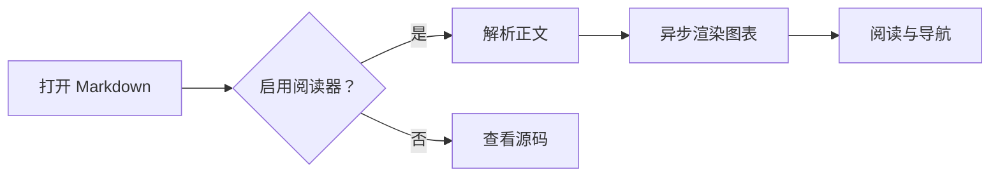
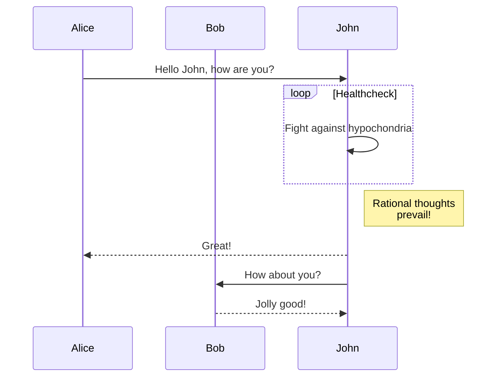
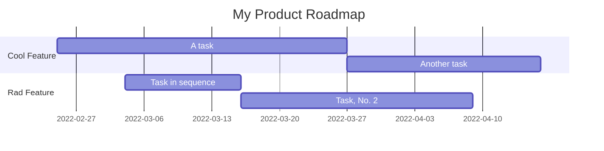
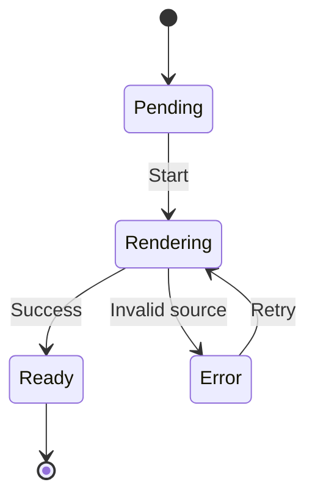
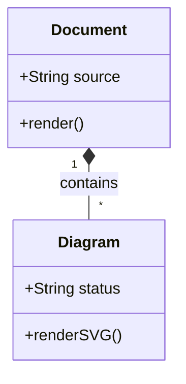
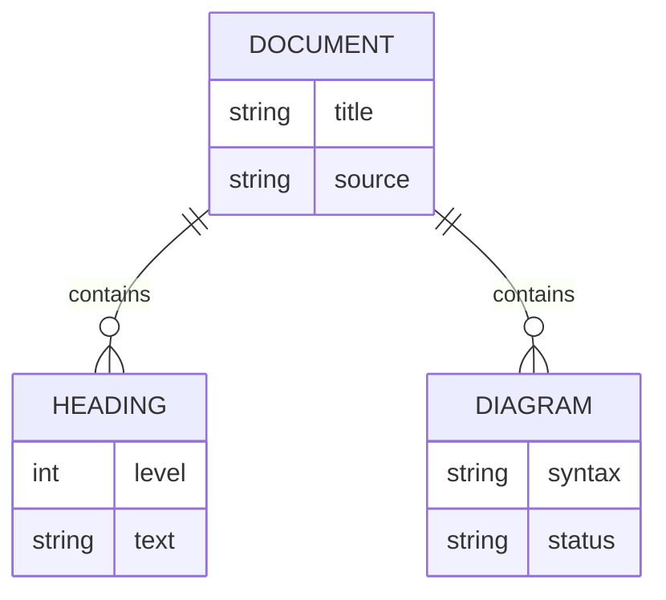
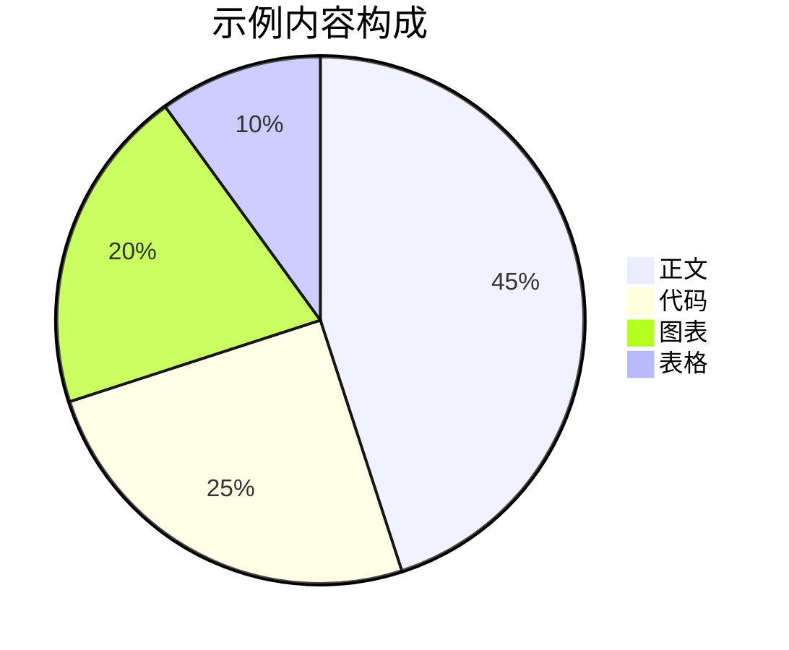
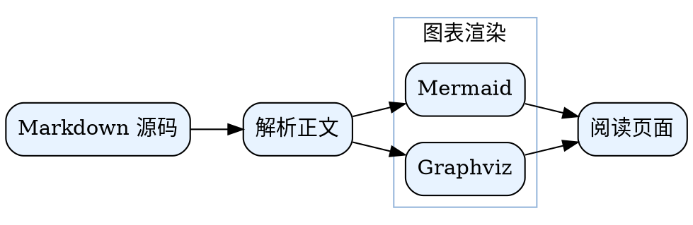
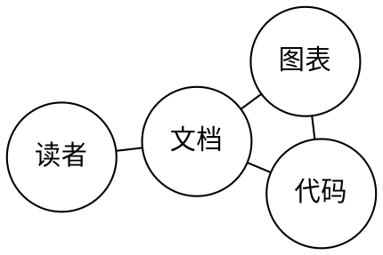

<a id="document-top"></a>

# Markdown Reader 功能展示

这份文档用于预览当前支持的 Markdown 语法、13 个可选插件，以及图表、表格和阅读交互。中英文示例放在一起，方便检查字体、换行和深浅主题。

> [!TIP]
> 请开启全部语法插件，尤其是 **Mermaid** 和 **Alert**。Graphviz 与 Mermaid 共用开关。Chrome 的标签页标题会使用上面的第一个一级标题。

## 阅读效果检查

- 切换浅色、深色和自动主题，观察文字、代码、公式、表格和图表。
- 切换居中与全宽布局，再收起、展开侧栏，观察宽表格的边界。
- 开启代码行号，将鼠标移到代码块上，点击复制按钮。
- 点击侧栏目录或标题旁的锚点；滚动到页面底部后使用回到顶部按钮。
- 在 Chrome 中切换源码视图；开启自动刷新后，保存本文件观察更新。
- 在 VS Code 中保存文件或使用预览工具栏的刷新按钮。
- 点击图片预览大图；缩小窗口检查手机宽度下的排版。
- 在 Chrome 中打印或导出 PDF，检查打印版式。

## 文内目录

下面由 **TOC** 插件生成，与阅读器侧栏目录可以同时使用。

[[toc]]

## 标题层级

一级标题位于文档顶部，下面展示二至六级标题。

## h2 Heading

### h3 Heading

#### h4 Heading

##### h5 Heading

###### h6 Heading

## Typographic replacements

`+- (c) (C) (r) (R) (tm) (TM)`

+- (c) (C) (r) (R) (tm) (TM)

`!!!!!! ???? ,, -- ---`

!!!!!! ???? ,, -- ---

`example.. example... example..... example?..... example!....`

example.. example... example..... example?..... example!....

`"Smartypants, double quotes" and 'single quotes'`

"Smartypants, double quotes" and 'single quotes'

## Emphasis

_This is italic text_

**This is bold text**

~~Strikethrough~~

~~**_This is italic and bold text_**~~

中文样例：**重点内容**、_轻声提示_、~~过期方案~~、**_粗斜体组合_**。

中文标点紧贴后续文字时，也需要遵循 Markdown 的强调边界规则：

| 源码                 | 渲染效果           |
| -------------------- | ------------------ |
| `**最终实现。** MCP` | **最终实现。** MCP |
| `**最终实现**MCP`    | **最终实现**MCP    |
| `**最终实现。**MCP`  | **最终实现。**MCP  |

最后一行保留星号是标准解析行为，可用于对照查看。

转义字符：\*不是斜体\*、\# 不是标题、\`不是代码\`。

软换行：
这行与上一行属于同一段落。

硬换行（上一行末尾有两个空格）：  
这行应另起一行，仍然属于同一段落。

## Blockquotes

> Blockquotes can also be nested...
>
> > ...by using additional greater-than signs right next to each other...

> > > ...or with spaces between arrows.

## Lists

Unordered

- Create a list by starting a line with `+`, `-`, or `*`
- Sub-lists are made by indenting 2 spaces:
  - Marker character change forces new list start:
    - Ac tristique libero volutpat at
    * Facilisis in pretium nisl aliquet
    - Nulla volutpat aliquam velit
- Very easy!

Ordered

1. Lorem ipsum dolor sit amet
2. Consectetur adipiscing elit
3. Integer molestie lorem at massa

4. You can use sequential numbers...
5. ...or keep all the numbers as `1.`

Start numbering with offset:

57. foo
1. bar

## Code

Inline `code`

Indented code

    // Some comments with indented code
    line 1 of code
    line 2 of code
    line 3 of code

Syntax highlighting

```typescript
function factorial(n: number): number {
  if (n === 0) {
    return 1
  }
  return n * factorial(n - 1)
}

const num: number = 5
console.log(`The factorial of ${num} is ${factorial(num)}`)
```

```python
def factorial(n):
    if n == 0:
        return 1
    else:
        return n * factorial(n-1)

num = 5
print(f"The factorial of {num} is {factorial(num)}")
```

## Tables

| Option | Description                                                               |
| ------ | ------------------------------------------------------------------------- |
| data   | path to data files to supply the data that will be passed into templates. |
| engine | engine to be used for processing templates. Handlebars is the default.    |
| ext    | extension to be used for dest files.                                      |

Right aligned columns

| Option |                                                               Description |
| -----: | ------------------------------------------------------------------------: |
|   data | path to data files to supply the data that will be passed into templates. |
| engine |    engine to be used for processing templates. Handlebars is the default. |
|    ext |                                      extension to be used for dest files. |

### 混合对齐与行内内容

| 左对齐                                                 |   居中   | 右对齐 |
| :----------------------------------------------------- | :------: | -----: |
| **加粗**                                               | :smile:  |    128 |
| `const value = 42`                                     |  $x^2$   |   3.14 |
| [项目主页](https://github.com/leizongmin/my-md-reader) | ~~删除~~ |  1,024 |
| 转义竖线：a \| b                                       | ==标记== |      0 |

### 宽表格与短列

居中模式下，宽表格可以超过正文宽度，向两侧留白扩展。缩小窗口后，观察短列、中文换行、长英文单词和表格内部横向滚动。

|  ID | 功能   | 中文说明                                                                           | English description                                                                      |        状态        | 默认设置     | 观察重点       |
| --: | ------ | ---------------------------------------------------------------------------------- | ---------------------------------------------------------------------------------------- | :----------------: | ------------ | -------------- |
|   1 | 标题   | 浏览器使用第一个一级标题作为标签页标题，中文、空格与行内强调应显示为可读的纯文本。 | The first level-one heading supplies the browser tab title.                              | :white_check_mark: | 自动         | 标题与侧栏     |
|   2 | 图表   | 图表在正文插入后异步渲染；中文节点、连线和分组应清晰，图表过宽时仍保持可阅读。     | Asynchronous Mermaid and Graphviz rendering with readable labels and edges.              | :white_check_mark: | Mermaid 开启 | 图表宽度       |
|   3 | 表格   | 短列保留紧凑宽度，较长说明按内容换行；无法容纳的内容可以在表格内部横向滚动。       | Short columns stay compact while descriptive columns wrap to the available space.        | :white_check_mark: | 自动         | 短列与长句     |
|   4 | 长单词 | 中文连续文本可以在合适位置换行，英文完整单词用于检查列宽与滚动边界。               | supercalifragilisticexpialidocious / https://example.com/a/very/long/path/without/spaces |         OK         | 自动         | 页面不整体溢出 |

### 多级表头、横向合并、分段与表题

MultiMarkdown 表格支持多个表头、`||` 横向合并、空行分段及表题。

<!-- prettier-ignore-start -->

| 分组 | 阅读设置 ||
| 功能 | Chrome | VS Code |
| --- | :---: | :---: |
| 主题 | 浅色 / 深色 / 自动 ||
| 图表 | Mermaid / Graphviz ||

| 代码行号 | 支持 | 支持 |
| 文档刷新 | 自动刷新开关 | 保存后刷新 |
[两端阅读能力示例]

<!-- prettier-ignore-end -->

### HTML 合并单元格

纵向合并通过原生 HTML 展示；当前没有开启 MultiMarkdown 的 `^^` 纵向合并、无表头和多行块内容选项。

<table>
  <thead>
    <tr><th rowspan="2">类别</th><th colspan="2">支持内容</th></tr>
    <tr><th>语法</th><th>展示重点</th></tr>
  </thead>
  <tbody>
    <tr><td rowspan="2">图表</td><td>Mermaid</td><td>流程、时序、甘特、状态、类、ER 和饼图</td></tr>
    <tr><td>Graphviz</td><td>有向图、无向图、分组与中文标签</td></tr>
    <tr><td>表格</td><td colspan="2">合并单元格保持列对齐，窄屏可横向滚动</td></tr>
  </tbody>
</table>

## Horizontal Rules

`---`

---

`___`

---

`***`

---

## Links

[link text](http://dev.nodeca.com)

[link with title](http://nodeca.github.io/pica/demo/ 'title text!')

Autoconverted link https://github.com/nodeca/pica (Auto linkify)

自动邮箱链接：reader@example.com。

参考式链接：[项目仓库][reader-repo]；相对路径：[中文说明](../README-cn.md)。

[reader-repo]: https://github.com/leizongmin/my-md-reader 'Markdown Reader'

显式 HTML 锚点：[跳到 HTML 示例](#html-demo)；[返回文档顶部](#document-top)。

本地文件协议示例：`[本地文档](file:///path/to/document.md)`。将示例路径替换成自己的文件地址后可以测试。

## Images


Image with title:


Like links, Images also have a footnote style syntax `![Alt text][id]`:

![Alt text][id]

With a reference later in the document defining the URL location:

`[id]: https://octodex.github.com/images/nyantocat.gif "Nyantocat"`

[id]: https://octodex.github.com/images/nyantocat.gif 'Nyantocat'

## Plugins

Very effective [syntax plugins](https://www.npmjs.org/browse/keyword/markdown-it-plugin) from `markdown-it`:

### [Emoji](https://github.com/markdown-it/markdown-it-emoji)

Classic markup:

`:wink: :cry: :laughing: :yum: :100: :dog: :cat:`

:wink: :cry: :laughing: :yum: :100: :dog: :cat:

Shortcuts (emoticons):

`:-) :-( 8-) ;)`

:-) :-( 8-) ;)

### [Subscript](https://github.com/markdown-it/markdown-it-sub) / [Superscript](https://github.com/markdown-it/markdown-it-sup)

- 19^th^
- H~2~O

### [Task lists](https://github.com/revin/markdown-it-task-lists)

- [x] Todo 1
- [ ] Todo 2

### [KaTeX](https://github.com/waylonflinn/markdown-it-katex)

$\sqrt{3x-1}+(1+x)^2$

$\sum_{i=0}^N\int_{a}^{b}g(t,i)\text{d}t$

$$
\begin{array}{c}
\nabla \times \vec{\mathbf{B}} -\, \frac1c\, \frac{\partial\vec{\mathbf{E}}}{\partial t} &
= \frac{4\pi}{c}\vec{\mathbf{j}}    \nabla \cdot \vec{\mathbf{E}} & = 4 \pi \rho \\
\nabla \times \vec{\mathbf{E}}\, +\, \frac1c\, \frac{\partial\vec{\mathbf{B}}}{\partial t} & = \vec{\mathbf{0}} \\
\nabla \cdot \vec{\mathbf{B}} & = 0
\end{array}
$$

$$
\begin{bmatrix}
{a_{11}}&{a_{12}}&{\cdots}&{a_{1n}}\\
{a_{21}}&{a_{22}}&{\cdots}&{a_{2n}}\\
{\vdots}&{\vdots}&{\ddots}&{\vdots}\\
{a_{m1}}&{a_{m2}}&{\cdots}&{a_{mn}}\\
\end{bmatrix}
$$

<br />

| Symbol |    Case (Lower/Upper)     | Symbol |   Case (Lower/Upper)    |
| :----: | :-----------------------: | :----: | :---------------------: |
|   α    |  $\alpha$ - $\mathrm{A}$  |   ν    |  $\nu$ - $\mathrm{N}$   |
|   β    |  $\beta$ - $\mathrm{B}$   |   ξ    |      $\xi$ - $\Xi$      |
|   γ    |    $\gamma$ - $\Gamma$    |   π    |      $\pi$ - $\Pi$      |
|   δ    |    $\delta$ - $\Delta$    |   ρ    |     $\rho$ - $\Rho$     |
|   ε    | $\epsilon$ - $\mathrm{E}$ |   σ    |   $\sigma$ - $\Sigma$   |
|   ζ    |  $\zeta$ - $\mathrm{Z}$   |   τ    |  $\tau$ - $\mathrm{T}$  |
|   η    |   $\eta$ - $\mathrm{H}$   |   υ    | $\upsilon$ - $\Upsilon$ |
|   θ    |    $\theta$ - $\Theta$    |   φ    |     $\phi$ - $\Phi$     |
|   ι    |  $\iota$ - $\mathrm{I}$   |   χ    |  $\chi$ - $\mathrm{X}$  |
|   κ    |  $\kappa$ - $\mathrm{K}$  |   ψ    |     $\psi$ - $\Psi$     |
|   λ    |   $\lambda$ - $\Lambda$   |   ω    |   $\omega$ - $\Omega$   |
|   μ    |   $\mu$ - $\mathrm{M}$    |        |                         |

### [Mermaid](https://mermaid.js.org/)

所有 Mermaid 图表都使用 `mermaid` 围栏。以下覆盖几种常用图表类型。

#### 流程图



#### 时序图



#### 甘特图



#### 状态图



#### 类图



#### 实体关系图



#### 饼图



### Graphviz / DOT

开启 **Mermaid** 插件后，`dot`、`digraph`、`graphviz` 围栏都能渲染 Graphviz。使用这些围栏更便于表达图表类型。

#### DOT 有向图：中文标签与分组



#### digraph 围栏：条件分支

```digraph
digraph Preview {
    start [label="打开文档", shape=oval];
    check [label="包含图表？", shape=diamond];
    diagram [label="渲染 SVG"];
    text [label="显示正文"];
    start -> check;
    check -> diagram [label="是"];
    check -> text [label="否"];
    diagram -> text;
}
```

#### graphviz 围栏：无向图



#### Mermaid 围栏中的 DOT 兼容写法

```mermaid
strict digraph Compatibility {
    a [label="Mermaid 围栏"];
    b [label="识别 DOT"];
    c [label="Graphviz SVG"];
    a -> b -> c;
}
```

#### 错误展示

下面故意保留一段无效 DOT：应显示错误信息并保留原始代码，便于检查失败时的样式。

```dot
digraph Invalid {
    a -> ;
}
```

### [Inserted](https://github.com/markdown-it/markdown-it-ins)

++Inserted text++

`++Inserted text++`

### [Marked](https://github.com/markdown-it/markdown-it-mark)

==Marked text==

`==Marked text==`

### [Abbreviations](https://github.com/markdown-it/markdown-it-abbr)

This is HTML abbreviation example.

It converts "HTML", but keep intact partial entries like "xxxHTMLyyy" and so on.

`*[HTML]: Hyper Text Markup Language`

*[HTML]: Hyper Text Markup Language

*[CSS]: Cascading Style Sheets

HTML 与 CSS 应出现缩写说明；xxxHTMLyyy 保持普通文字。

### [Definition lists](https://github.com/markdown-it/markdown-it-deflist)

Term 1

: Definition 1
with lazy continuation.

Term 2 with _inline markup_

: Definition 2

        { some code, part of Definition 2 }

    Third paragraph of definition 2.

_Compact style:_

Term 1
~ Definition 1

Term 2
~ Definition 2a
~ Definition 2b

### [Footnotes](https://github.com/markdown-it/markdown-it-footnote)

Footnote 1 link[^first].

Footnote 2 link[^second].

Inline footnote^[Text of inline footnote] definition.

Duplicated footnote reference[^second].

[^first]: Footnote **can have markup**

    and multiple paragraphs.

[^second]: Footnote text.

### [Custom containers](https://github.com/markdown-it/markdown-it-container)

::: info
Stay hungry, stay foolish.
:::

::: tip
**In the middle of difficulty lies opportunity.**
:::

::: success
千里之行，始于足下。
:::

::: warning
_Fortune favors the bold._
:::

::: danger
**_Hic sunt dracones!_**
:::

别名容器：

::: note
`note` 与 `info` 使用相同的提示样式。
:::

::: tips
`tips` 与 `tip` 使用相同的建议样式。
:::

### [Alert](https://github.com/mdit-plugins/mdit-plugins)

> [!NOTE]
> Useful information that users should know, even when skimming content.

> [!TIP]
> Helpful advice for doing things better or more easily.

> [!IMPORTANT]
> Key information users need to know to achieve their goal.

> [!WARNING]
> Urgent info that needs immediate user attention to avoid problems.

> [!CAUTION]
> Advises about risks or negative outcomes of certain actions.

嵌套提示：

> [!NOTE]
> 外层提示中仍可使用 **加粗**、`代码` 和列表。
>
> - 阅读正文
> - 检查嵌套提示
>
> > [!TIP]
> > 内层提示应有独立的标题与样式。

## 原生 HTML

<a id="html-demo"></a>

HTML 内容可以与 Markdown 并存。下面展示折叠区域、键盘按键、上下标和换行。

<details>
  <summary>点击展开补充说明</summary>
  <p>这是 details / summary 折叠区域，可用于放置不需要默认展开的补充信息。</p>
  <p>HTML 区域内使用 <strong>HTML 加粗</strong> 和 <code>HTML 代码</code>。</p>
</details>

快捷键外观：<kbd>Ctrl</kbd> + <kbd>C</kbd>；<kbd>⌘</kbd> + <kbd>P</kbd>。

HTML 上下标：H<sub>2</sub>O、x<sup>2</sup>。

第一行<br />第二行。

实体字符：&copy; &reg; &trade; &amp; &lt; &gt; &nbsp;。

## 未指定语言的代码与转义

无语言围栏应保留纯文本，其中的 HTML 不应成为页面元素。

```
<section title="示例">
  **这里仍然是代码**
  a & b < c
</section>
```

未知语言同样保留源码：

```unknown-language
SELECT custom_syntax FROM example;
```

## 预览结束

如果你已经滚动到这里，可以检查回到顶部按钮、侧栏当前章节、脚注返回链接，以及深色主题下各元素的对比度。
